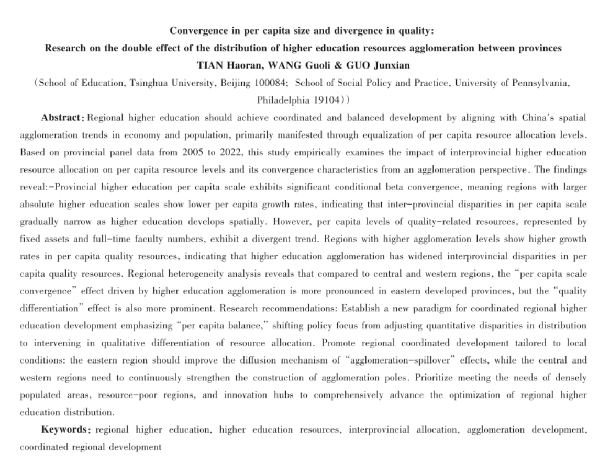
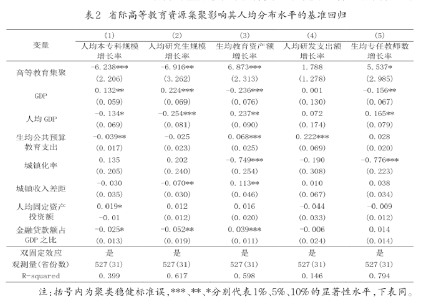
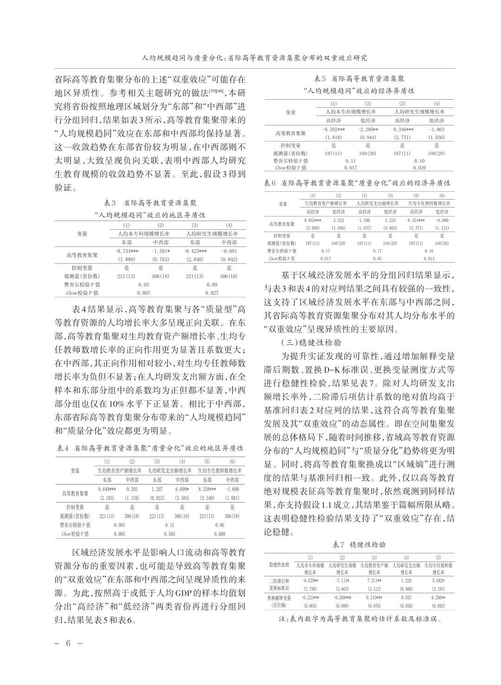
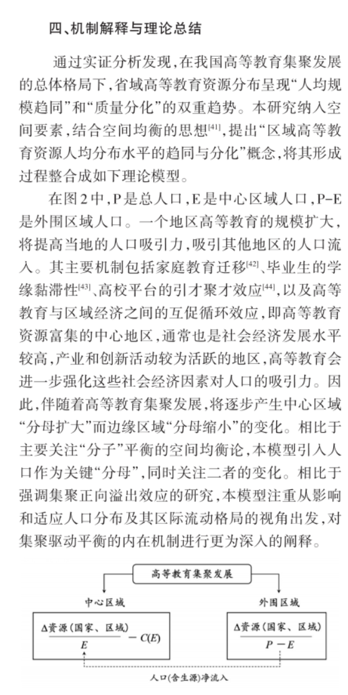

# Provincial panel modeling of higher education resource distribution

[← Profile](./README.md)

*教育发展研究*, 2026 · **CSSCI** · Coauthored empirical study

## Study overview

How can regional higher education become more equal in per-capita scale while quality-related resources become more unequal?

The study examines this dual pattern using provincial panel data and develops a spatial explanation that considers changes in both educational resources and population.

## Quantitative design

| Component | Design |
| --- | --- |
| Panel | 31 Chinese provinces, 2005–2022; the baseline growth regressions report 527 province-year observations. |
| Outcomes | Growth in per-capita undergraduate and postgraduate enrollment, assets per student, R&D spending per person, and full-time faculty per student. |
| Model | Province and year fixed effects, with economic and demographic controls. |
| Heterogeneity | Eastern versus central/western regions; higher- versus lower-income provincial groups. |
| Robustness | Lagged explanatory variables, Driscoll–Kraay standard errors, and alternative agglomeration measures. |

### Baseline findings

- **Scale convergence:** agglomeration is negatively associated with per-capita undergraduate and postgraduate enrollment growth.
- **Resource divergence:** agglomeration is positively associated with growth in assets and faculty per student. The baseline R&D-spending coefficient is not statistically significant.
- **Regional differences:** the convergence/divergence pattern is more pronounced in eastern provinces; economic subgroup comparisons help characterize this heterogeneity.

Regional and economic heterogeneity · robustness checks

## Proposed mechanism: population mobility changes the denominator

The study's theoretical explanation treats the population denominator as part of the spatial adjustment process, alongside the educational-resource numerator.

1. **Agglomeration increases the attraction of the central region.** Proposed channels include education-related household migration, graduates' attachment to their study location, university talent attraction, and interactions between higher education and the local economy.
2. **Population shifts change per-capita measures.** Inflows expand the central region's denominator while outflows reduce the peripheral region's denominator. Resource growth and per-capita growth can therefore move differently.
3. **Scale and quality-related resources need not equalize together.** This population adjustment offers an explanation for scale convergence, while the estimates show continued divergence in selected resource measures. The study argues for attention to both population distribution and resource composition, including agglomeration–spillover mechanisms.

**Interpretation:** the panel results document conditional associations. The population-mobility channels above are proposed mechanisms, not separately identified causal mediation effects.

*Figures reproduce supplied excerpts from the coauthored publication; their original labels and attribution are retained.*
