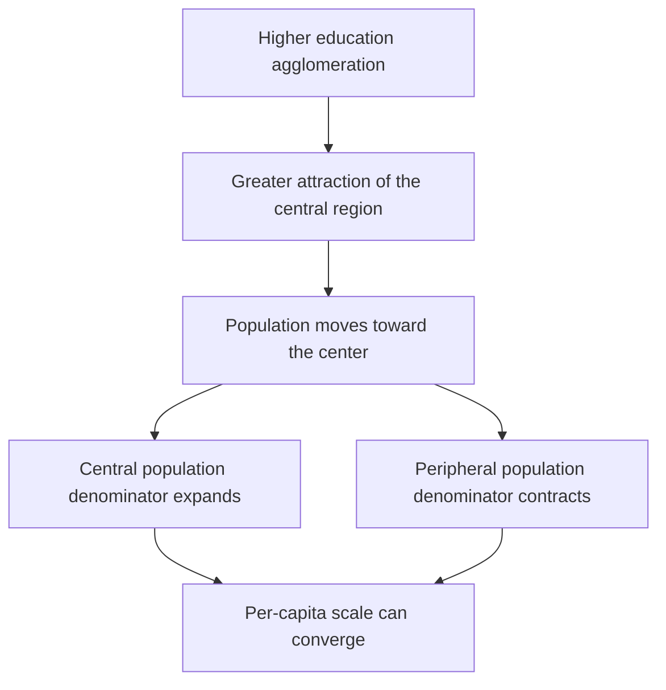

# Provincial panel modeling of higher education resource distribution

[← Profile](./README.md)

*教育发展研究* · 2026 · **CSSCI**

**31 provinces · 2005–2022 · 527 observations in each baseline regression**

## The question

Does the spatial concentration of higher education narrow regional inequalities—or reinforce them?

This study distinguishes **enrollment scale** from **quality-related resources**. Its central finding is a dual pattern: per-capita enrollment scale converges, while selected resource measures diverge. More equal access in scale does not necessarily mean more equal educational resources.

## Quantitative approach

A provincial panel model relates resource growth to higher education agglomeration, using **province and year fixed effects**. Controls cover economic size and development, education expenditure, urbanization, income disparities, investment, and finance.

The analysis combines three layers:

| Estimation | Comparison | Validation |
| --- | --- | --- |
| Five growth outcomes spanning enrollment, assets, R&D, and faculty | Eastern vs. central/western provinces; higher- vs. lower-income groups | Lagged explanatory variables, Driscoll–Kraay standard errors, and alternative agglomeration measures |

## What the estimates show

**Scale converges.** The agglomeration coefficients for undergraduate and postgraduate enrollment growth are negative, consistent with the study's interpretation of convergence in per-capita scale.

**Selected resources diverge.** Assets and faculty per student show positive coefficients. The baseline association for R&D spending is not statistically significant.

| Growth outcome | Agglomeration coefficient | Standard error | Statistical evidence |
| --- | ---: | ---: | --- |
| Undergraduate enrollment per capita | −6.238 | 2.206 | p < .01 |
| Postgraduate enrollment per capita | −6.916 | 3.262 | p < .05 |
| Educational assets per student | +6.873 | 2.313 | p < .01 |
| R&D spending per capita | +1.788 | 1.278 | Not significant at 10% |
| Full-time faculty per student | +5.537 | 2.985 | p < .10 |

Selected coefficients from the published baseline table; standard errors are clustered. Coefficients are reported on the original model scale, not as percentage-point effects. Every specification includes province and year fixed effects and controls.

<strong>Regional variation & robustness</strong>

The dual pattern is more pronounced in eastern provinces. Undergraduate scale convergence appears in both regional groups, while the postgraduate result is less clear in central/western provinces. The positive associations for assets and faculty are also stronger in the east.

Grouping provinces by economic development produces broadly similar contrasts, supporting economic context as a possible explanation for regional heterogeneity. Lagged specifications, Driscoll–Kraay standard errors, and alternative agglomeration measures examine the sensitivity of the main findings.

## Proposed mechanism

### Population mobility changes the denominator

The theoretical contribution is to consider **population adjustment alongside resource growth**. A region can attract more educational resources and more people at the same time; its per-capita outcome depends on both.

Proposed channels include education-related household migration, graduates remaining near their institutions, universities attracting talent, and mutually reinforcing links between higher education and the regional economy.

This mechanism helps explain why spatial concentration can coexist with **convergence in per-capita scale**. The observed divergence in assets and faculty shows why resource composition must be examined separately from enrollment scale.

**Policy implication:** assess regional balance through both population and resources, with attention to the diffusion of agglomeration benefits and the needs of densely populated or resource-poor areas.

---

This page summarizes a coauthored study. Panel estimates describe conditional associations; the mobility channels are a proposed theoretical explanation, not separately identified causal mediation effects. “Quality-related resources” refers to measured inputs, not a direct measure of educational quality.
